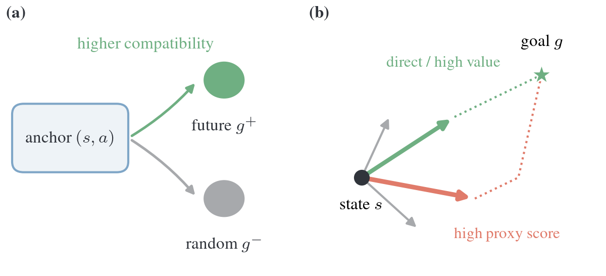

# Goal Retrieval versus Action-Value Ordering: Contrastive Critics under Best-of-K Selection

<p align="center">
  <a href="https://arxiv.org/abs/2607.27422"></a>
  &nbsp;
  <a href="https://siddharthaphale.github.io/blog/2026/goal-retrieval-vs-action-ordering"></a>
  &nbsp;
  <a href="https://ptaworkshop.github.io/"></a>
</p>

Strong goal retrieval does not guarantee good action selection. We compare
contrastive critics on shared state–goal queries and frozen action pools,
using controlled experiments and OGBench to measure best-of-K action ordering.

<p align="center">
  
</p>

---

## Install

Use [uv](https://docs.astral.sh/uv/) with Python 3.12. The locked JAX/Flax/MuJoCo
stack was validated on DGX Spark (aarch64, NVIDIA GB10).

```bash
uv sync --locked --extra experiments --extra cuda
uv run --no-sync python -m crlo.utils.ogbench_vendor --install
```

GPU runs require an NVIDIA driver and MuJoCo EGL. For CPU-only use, omit
`--extra cuda` and set `JAX_PLATFORMS=cpu`. The installer verifies the pinned
OGBench agent checkout; OGBench 1.2.1 supplies the environments.

---

## Repository layout

```text
crl-ordering/
├── src/crlo/      agents, environments, training, and evaluation
├── experiments/  experiment entry points
├── config/       critic, controlled critic, and diffusion recipes
├── tests/        CPU and GPU suites
└── assets/       README illustration
```

---

## Running experiments

```bash
export JAX_PLATFORMS=cuda MUJOCO_GL=egl
export XLA_PYTHON_CLIENT_PREALLOCATE=false PYTHONUNBUFFERED=1

# Train an OGBench critic.
uv run --no-sync python experiments/train_critic.py \
  --task pointmaze-large-navigate-v0 --critic cosine --seed 42 \
  --output-dir checkpoints/pointmaze_cosine

# Train and evaluate the exact-value controlled problem.
uv run --no-sync python experiments/train_controlled_critic.py \
  --output-dir checkpoints/controlled
uv run --no-sync python experiments/evaluate_controlled_best_of_k.py \
  --checkpoint-dir checkpoints/controlled --output-dir results/controlled
```

---

## Citation

```bibtex
@inproceedings{singh2026goalretrieval,
  title     = {Goal Retrieval versus Action-Value Ordering: Contrastive Critics under Best-of-K Selection},
  author    = {Singh, Ayushman and Aphale, Siddharth},
  booktitle = {From Pretrained Representations to Acting Agents (PTA) Workshop at NeurIPS},
  year      = {2026},
  eprint    = {2607.27422},
  archivePrefix = {arXiv},
  primaryClass  = {cs.LG},
  url       = {https://arxiv.org/abs/2607.27422}
}
```

Also available in [CITATION.bib](CITATION.bib).

---

## License and attribution

The code is [MIT licensed](LICENSE). OGBench software and datasets retain their
upstream terms. README layout inspired by
[entropy-collapse-rlvr](https://github.com/siddharthaphale/entropy-collapse-rlvr).
